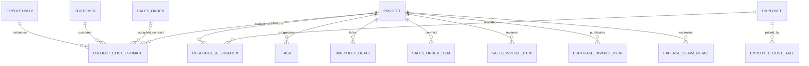

# Project Costing MVP — Flowire backend

This feature is implemented in the separately versioned `flowire` app. It does not edit
Frappe/ERPNext/HRMS source, create fields on standard doctypes, or replace standard transaction
records.

## Scope and dependencies

The backend owns exactly three business DocTypes:

1. **Project Cost Estimate** — presales estimate and project budget baseline.
2. **Employee Cost Rate** — effective-dated cost and billing rates.
3. **Resource Allocation** — employee participation and planned project hours.

The Project Cost Engine is a Python service and read-only API, not a DocType. Project, Task,
Timesheet, Sales Order, Sales Invoice, Purchase Invoice, Expense Claim, Employee, and Holiday List
remain standard ERPNext/HRMS records.

Resource costing requires a compatible HRMS installation providing Employee, Timesheet,
Timesheet Detail, and Holiday List. Flowire does not currently make HRMS a hard install dependency,
so other Flowire features can still install on an ERPNext-only site. Project costing endpoints fail
explicitly when those HRMS doctypes are unavailable. Verify that the deployed HRMS major matches
the ERPNext/Frappe major before enabling this feature.

## Data model

### Project Cost Estimate

Links: Company, Customer, Opportunity, Quotation, Sales Order, and optional Project.
`company` is required so every estimate amount is in the company's default currency.

Inputs: estimated revenue; estimated labor and purchase costs; travel, software, subcontractor,
and miscellaneous estimate categories. The expense total, total cost, expected profit, and expected
margin are server-calculated and read-only.

`status` is a lightweight Draft / Approved / Rejected selector, not a workflow. Only one Approved
estimate may be linked to a Project or accepted Sales Order. A linked approved estimate supplies
the budget comparison; without one, over-budget is unknown rather than false.

### Employee Cost Rate

Fields: Employee, derived Company, Cost Rate Per Hour, Billing Rate Per Hour, Effective Date, Active.
Company is derived from Employee and keeps rates in the company base currency. An employee cannot
have two rates with the same effective date.

On project Timesheet validation, the latest active rate effective on the time-log date is converted
to the Timesheet currency and written to ERPNext's standard `Timesheet Detail.costing_rate`.
ERPNext calculates and stores its standard costing amounts. Submitting project hours without an
effective rate is rejected with a row-specific message; non-project Timesheets are unchanged.
Rate values and effective dates are protected from edits/deletion once submitted project Timesheets
use them. Existing submitted Timesheets are not rewritten; review them against the initial rates
before treating historical labor totals as complete. Billing Rate Per Hour is exposed for reference
but does not replace invoiced revenue.

### Resource Allocation

Fields: Project, Employee, Role, Allocation Percentage, Planned Hours, Start Date, and End Date.
Date ranges are required and inclusive. Overlapping allocations for the same employee/project are
rejected to avoid double-counting planned effort. Allocations across different projects are allowed;
current commitments above 100% are reported as a warning, not silently blocked.

## Source-of-truth rules and formulas

All actual amounts are read in company base currency from submitted documents only. Item-level
Project takes precedence; a parent Project link is used only when the item Project is blank.
Cancelled and draft documents are excluded.

| Metric | Source and calculation |
|---|---|
| Contract Value | Submitted Sales Order item `base_net_amount`; item Project, Sales Order Project, or the linked Project's Sales Order. Tax is excluded. |
| Actual Revenue | Submitted Sales Invoice item `base_net_amount`; returns reduce revenue. |
| Labor Cost | Submitted project Timesheet Detail `base_costing_amount`; the standard ERPNext costing rate is populated from the effective Flowire Employee Cost Rate. |
| Purchase Cost | Submitted Purchase Invoice item `base_net_amount`; returns reduce cost. |
| Expense Cost | Approved, submitted Expense Claim Detail `base_sanctioned_amount`; rejected and draft claims are excluded. |
| Total Cost | Labor Cost + Purchase Cost + Expense Cost. |
| Profit | Actual Revenue − Total Cost. |
| Margin | Profit ÷ Actual Revenue × 100; `null` when actual revenue is zero. |
| Profitable | Profit is greater than zero. |
| Over Budget | Total Cost exceeds the linked Approved estimate; `null` if there is no approved estimate. |
| Progress | Completed Tasks ÷ non-cancelled, non-template Tasks × 100; 0% when there are no eligible Tasks. |
| Overdue | Today is later than Project expected end date and status is not Completed. |
| Available Hours | 8 hours per calendar working day, excluding the Employee Holiday List (or Company default); half-day holidays count as 4 hours. Employment start and relieving dates are respected. |
| Utilization | Submitted Timesheet hours in the selected period ÷ Available Hours × 100. If no calendar covers the period, capacity and utilization are `null` with a warning. |
| Planned Hours | Resource Allocation Planned Hours prorated to the selected date range by working days over the full allocation period. |

## APIs

All endpoints are authenticated, role-gated, and read-only:

- `flowire.flowire.project_costing.get_project_financials(project)` — financial summary, budget,
  progress, overdue state, assigned employees, and data-completeness warnings.
- `flowire.flowire.project_costing.get_employee_summary(employee, start_date, end_date)` —
  assignments, period planned/actual/available hours, utilization, current rate, and project labor
  contribution. Defaults to month-to-date.
- `flowire.flowire.project_costing.get_executive_summary(company, start_date, end_date)` —
  company-currency project totals, counts, overdue projects, top five profitable and loss-making
  projects, data warnings, and aggregate employee utilization. The date range defaults to
  month-to-date and applies to employee utilization; project financials are cumulative as of the
  request date.

Executive totals require one company so amounts are never added across currencies. Active projects
exclude Completed and Cancelled. Average Margin is the weighted company margin
(`total profit ÷ total actual revenue`), not an arithmetic average of project margins. The top and
loss lists contain up to five projects each. Project and employee records follow the caller's
Frappe read permissions. If any visible employee lacks a holiday calendar covering the selected
period, aggregate utilization is `null` and the response includes a warning rather than reporting
a partial percentage.

The executive summary degrades rather than failing when the caller may not read Employee records:
`employee_utilization.permitted` is `false`, `utilization_percentage` and `available_hours` are
`null`, counts and hours are zero, and a warning explains why. Project financials are still
returned. Employee records are not read at all in that path. `permitted` is `true` whenever
utilization was actually computed, so a consumer can distinguish "cannot see it" from "no data".
The dedicated `get_employee_summary` endpoint is unchanged and still refuses such callers, because
it has nothing else to return.

### Verified role matrix (staging, 2026-11-17)

Read access at permission level 0, and the resulting `get_executive_summary` behaviour:

| Role | Company | Project | Employee | Executive summary |
|---|---|---|---|---|
| System Manager / Administrator | read | read | read | full |
| Accounts Manager | read | read | read | full |
| HR Manager | read | read | read | full |
| Projects Manager | **no read** | read | read | **403: company** |
| Projects User | read | read | no read | 403: role gate |
| Sales Manager / Sales User | read | no read | — | 403: role gate |

Two consequences worth planning for:

1. **Projects Manager cannot use the executive dashboard**, because standard ERPNext grants that
   role no `Company` read (while it does grant `Employee` read). The utilization degradation does
   not help them — the request fails at the company check. Enabling them requires granting
   `Company` read to the role; the endpoint is deliberately company-scoped, so it is not degraded.
2. With stock roles, no role that passes the `PROJECT_COSTING_ROLES` gate lacks `Employee` read,
   so the degradation is defence-in-depth for custom or future role sets rather than a fix for a
   standard role today.

Project financial access is limited to System Manager, Accounts Manager, Projects Manager, and HR
Manager, and still checks Company and Project read permission. Employee-rate details are limited to
System Manager, Accounts Manager, and HR Manager, and still check Employee read permission.

No values are written back to Project or accounting documents. The API calculates from the current
submitted source records on each request, so cancellations and credit notes are reflected without
reconciliation jobs.

## Deployment and verification gates

The implementation was installed on an isolated v16 staging bench and migrated twice. The
22 Flowire integration tests pass there. The frontend/browser smoke test remains deferred. Before
enabling the feature:

1. Verify ERPNext and HRMS are on compatible v15 or v16 branches and that the standard fields above
   exist on the target version.
2. Run focused Flowire tests and exercise submitted/cancelled invoices, expense claims, and
   Timesheets with rate changes and multi-currency company setups.
3. Confirm the role matrix and Employee Holiday List coverage on staging before connecting the
   frontend.

The isolated staging bench uses Frappe 16.56.0, ERPNext 16.55.0, HRMS 16.53.2, and CRM 1.92.0.
The original Docker bench remains separate and was not modified for this validation.
